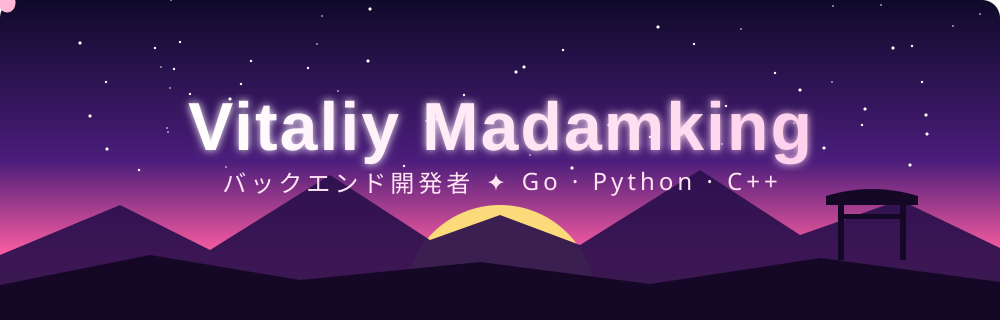
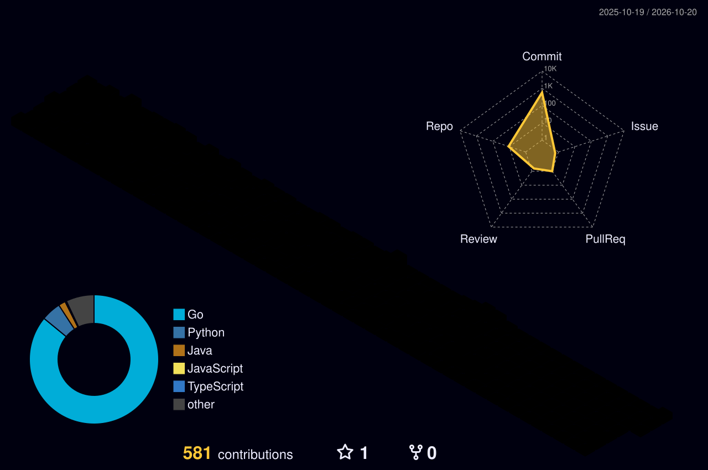

<p align="center">
  
</p>

<p align="center">
  
</p>

<p align="center">
  
  
  
  
  
</p>

---

## 🌸 Character sheet

```yaml
Name:    Vitaliy Madamking  (ヴィタリー)
Class:   Backend Mage ⚔️
Level:   always leveling up
Weapons: [Go, Python, C++, Java]
Quest:   Smartway — matching hotel records across providers
HP:      ██████████ 100%
MP:      ████████░░  80%   # refills with coffee ☕
Motto:   "xd go python c++"
```

## 🛠️ Skill tree

<p align="center">
  
</p>

## 🗡️ Quests

| Quest | Description |
|---|---|
| **[Smartway-back](https://github.com/Vitaliy-Madamking/Smartway-back)** 🐹 | Go service for deduplicating & matching hotel records from different travel providers |
| **[LERNING](https://github.com/Vitaliy-Madamking/LERNING)** ☕ | Java training grounds |
| **[anime-adaptetion](https://github.com/Vitaliy-Madamking/anime-adaptetion)** 🎌 | Side quest: anime project |

## 🌌 Contribution sky

<p align="center">
  
</p>
s

## 📊 Battle stats

<p align="center">
  
  
</p>
<p align="center">
  
</p>

<p align="center">
  
</p>
